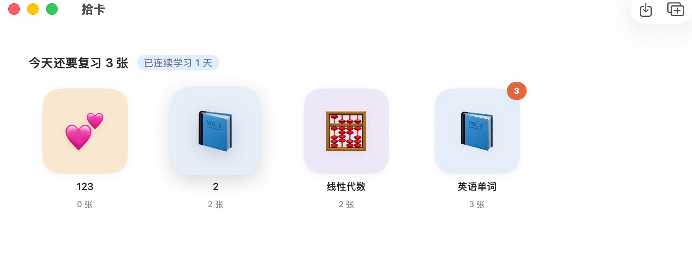
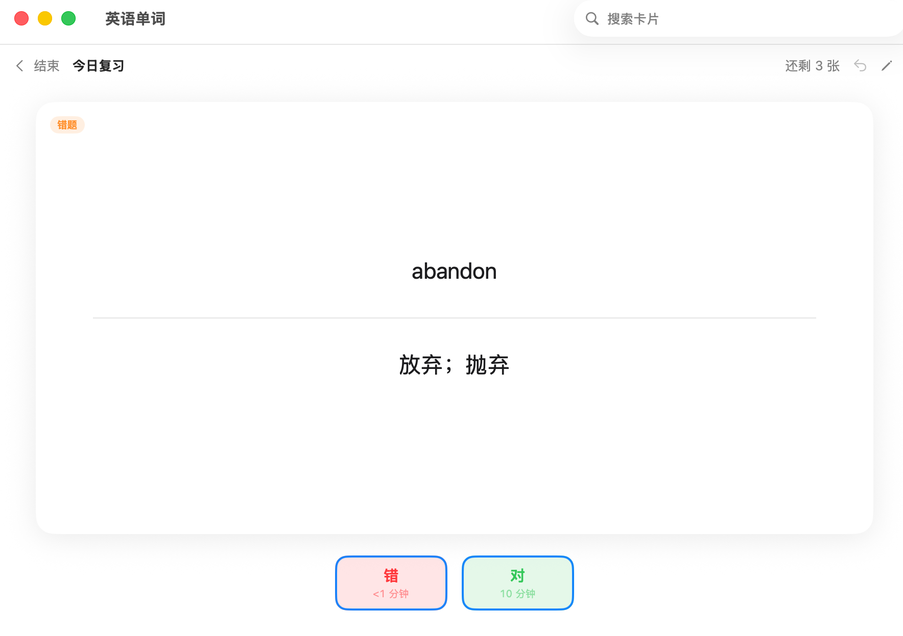
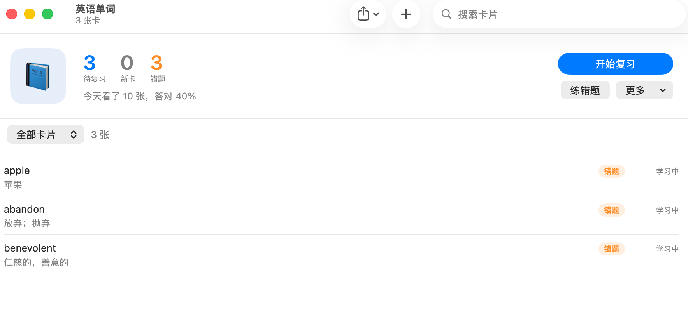
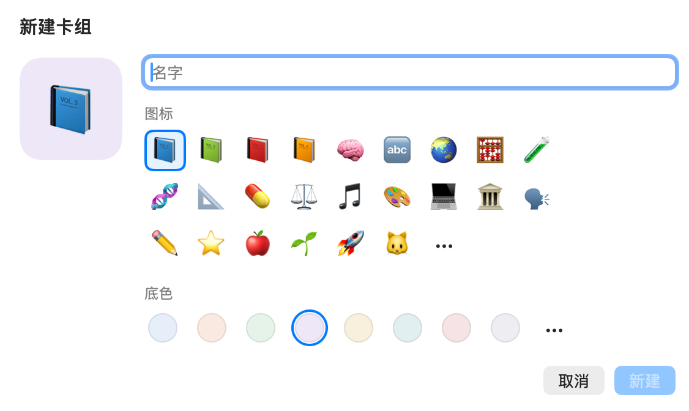

<p align="center">
  
</p>

<h1 align="center">拾卡 PikCard</h1>

<p align="center">
  超轻量的 Mac 原生背诵卡 · 每个卡组一个文件夹 · 卡片是普通的 Markdown 文件<br>
  A lightweight native Mac flashcard app · One folder per deck · Cards are plain Markdown files
</p>

<p align="center">
  <a href="https://github.com/houyue-9980/PikCard/releases/latest"><b>下载 Download</b></a>
  &nbsp;·&nbsp; 当前版本 Version <b>1.0.0</b>
  &nbsp;·&nbsp; macOS 15+
  <br><br>
  <a href="#中文">中文</a> &nbsp;|&nbsp; <a href="#english">English</a>
</p>

<p align="center"></p>
<p align="center"><sub>卡组书架：每个卡组一个图标，右上角是今天要复习的张数，拖动可以换位置 · Deck shelf: one icon per deck, today's count in the corner, drag to reorder</sub></p>

<p align="center"></p>
<p align="center"><sub>复习：空格翻面，← 错 / → 对 · Review: Space flips the card, ← wrong / → right</sub></p>

<table align="center">
  <tr>
    <td align="center"><br><sub>卡组页：待复习、新卡、错题 · Deck: due, new, mistakes</sub></td>
    <td align="center"><br><sub>新建卡组：任意表情、任意颜色 · New deck: any emoji, any color</sub></td>
  </tr>
</table>

---

## 中文

拾系列的第二款软件。翻卡片、回答对或错，拾卡按遗忘规律安排每张卡下次什么时候复习。数据永远在你自己手里：每个卡组就是一个普通文件夹，放进 iCloud 云盘或 OneDrive 就能同步。

> 拾系列的每款软件都用名字的第二个字做图标（拾记 → 记、拾卡 → 卡），右下角的橙色方块是整个系列共同的标记。

### 特点

- **数据在你手里**：你选一个文件夹，里面每个子文件夹是一个卡组。卡片存在 `cards.md`（普通 Markdown，用拾记、任何文本编辑器都能打开），复习进度存在 `progress.json`，图片声音放在 `media/`。卸掉拾卡，卡片一切如常
- **翻面**：按空格，卡片翻过来看答案
- **对 / 错，或者四档**：默认看完答案只选“对”或“错”（← →）；想安排得更细，设置里换成“忘了 / 难 / 记得 / 简单”（1–4）
- **按遗忘规律安排复习**：用的是 FSRS 算法（Anki 现在也在用），记得越牢，间隔越长；“一天”从凌晨 4 点算起
- **错题**：答错的卡自动进错题，可以单独反复练，连续答对 3 次自动移出
- **分类**：每张卡可以加分类（标签），复习或练习时可以只看某一类
- **导入导出**：Anki 卡组 `.apkg`（包括 Anki 新版的压缩格式，图片和声音一起导入）、`.csv`、`.tsv`。文件直接拖进窗口就能导入：拖到书架新建卡组，拖到卡组窗口加进这个卡组。导出的 `.apkg` 新旧 Anki 都能打开
- **书架**：拖动卡组换位置；图标可以选任意表情、任意底色
- **公式和图片**：卡片里可以写 Markdown 和公式（`$x^2$`），图片、声音直接拖进编辑框
- **全键盘**：空格看答案，← → 回答，⌘Z 撤销，E 编辑当前这张，Esc 结束
- **外观**：浅色 / 深色 / 护眼，中文 / English

### 卡片文件长什么样

```markdown
# 线性代数

<!-- card a1b2c3d4 #第三章 #易混 -->
矩阵可逆的条件是什么？

---

行列式不为 0。
```

`<!-- card 编号 #分类 -->` 开始一张卡，`---` 上面是正面、下面是背面。手写的时候也可以一行一张：`apple :: 苹果`，拾卡下次保存时会自动整理成上面的格式。

### 安装

1. 到 [Releases](https://github.com/houyue-9980/PikCard/releases/latest) 下载 `PikCard-1.0.0.dmg`，打开后把 **PikCard** 拖进“应用程序”
2. 拾卡没有经过苹果公证。第一次打开时请在“应用程序”里**右键点击 PikCard → 打开**，再在弹窗里点“打开”。之后就能正常双击打开了。如果没有“打开”按钮：打开 **系统设置 → 隐私与安全性**，在下面找到关于 PikCard 的提示，点“仍要打开”
3. 第一次使用时选一个卡片文件夹。选空文件夹的话，会放上一个使用教程卡组

需要 macOS 15 或更新版本，Apple 芯片的 Mac。

### 开发

需要 Xcode、Node.js 和 XcodeGen（`brew install xcodegen`）。

| 位置 | 内容 |
| --- | --- |
| `PikCard/App/` | 入口、设置、语言、外观 |
| `PikCard/Model/` | 卡片文件、复习进度、FSRS 算法、卡组和卡片库 |
| `PikCard/Deck/` | 卡组书架、卡组页、卡片编辑 |
| `PikCard/Review/` | 复习页面、卡片显示（网页） |
| `PikCard/Exchange/` | 导入导出：`.apkg`、`.csv`、`.tsv` |
| `PikCard/Resources/render/` | 显示卡片的网页（`lib/` 由 `render` 生成，不要手改） |
| `PikCard/Vendor/zstd/` | 官方 zstd 1.5.6 解压代码（读 Anki 新版卡组用） |
| `PikCardTests/` | 单元测试 |
| `tools/make-icon.swift` | 生成软件图标 |
| `tools/run-app.sh` | 编译并重新打开开发版 |

```bash
# 更新卡片显示用的 markdown-it 和 KaTeX
cd render && npm install && npm run build

# 改了 project.yml 或增删了 Swift 文件后重新生成项目
xcodegen

# 编译并打开开发版（开发版的设置和正式版分开存）
tools/run-app.sh

# 跑测试
xcodebuild -project PikCard.xcodeproj -scheme PikCard test
```

### 致谢

- [FSRS](https://github.com/open-spaced-repetition)：间隔重复算法
- [markdown-it](https://github.com/markdown-it/markdown-it)：Markdown 渲染
- [KaTeX](https://katex.org)：公式渲染
- [zstd](https://github.com/facebook/zstd)：解压 Anki 新版卡组
- [XcodeGen](https://github.com/yonaskolb/XcodeGen)：生成 Xcode 项目

---

## English

The second app in the 拾 series. Flip a card, answer right or wrong, and PikCard schedules the next review based on how memory fades. Your data stays yours: every deck is a plain folder, so iCloud Drive or OneDrive can sync it.

> Every app in the 拾 series uses the second character of its name as its icon (拾记 → 记, 拾卡 → 卡), and the orange square in the corner marks the whole family.

### Features

- **Your data stays yours**: pick a folder; each subfolder is a deck. Cards live in `cards.md` (plain Markdown that PikNote or any text editor can open), progress in `progress.json`, images and audio in `media/`. Uninstall PikCard and your cards are untouched
- **Flip**: press Space and the card turns over to show the answer
- **Right / Wrong, or four levels**: by default you just answer Right or Wrong (← →). For finer scheduling, switch to Again / Hard / Good / Easy (1–4) in Settings
- **Spaced repetition**: uses FSRS (the algorithm Anki uses today); the better you know a card, the longer until you see it again. A study day starts at 4 AM
- **Mistakes**: cards you get wrong go into Mistakes for focused practice, and leave after 3 right answers in a row
- **Tags**: tag cards and review or practice one tag at a time
- **Import & export**: Anki `.apkg` (including the newer compressed format, with images and audio), `.csv` and `.tsv`. Just drag files into a window: onto the shelf to create decks, onto a deck window to add to that deck. Exported `.apkg` files open in old and new Anki
- **Shelf**: drag decks to reorder; pick any emoji and any color for the icon
- **Math & images**: Markdown and math (`$x^2$`) in cards; drag images or audio into the editor
- **Keyboard first**: Space shows the answer, ← → answer, ⌘Z undoes, E edits the current card, Esc ends
- **Appearance**: Light / Dark / Sepia, English / 中文

### The card file

```markdown
# Linear Algebra

<!-- card a1b2c3d4 #chapter3 #tricky -->
When is a matrix invertible?

---

When its determinant is not 0.
```

`<!-- card id #tags -->` starts a card; above `---` is the front, below is the back. When writing by hand you can also put one card per line: `apple :: 苹果`. PikCard tidies it into the format above the next time it saves.

### Install

1. Download `PikCard-1.0.0.dmg` from [Releases](https://github.com/houyue-9980/PikCard/releases/latest), open it and drag **PikCard** into Applications
2. PikCard isn’t notarized by Apple. The first time, **right-click PikCard in Applications → Open**, then click Open. After that it opens normally. No Open button? Go to **System Settings → Privacy & Security** and click “Open Anyway” next to the message about PikCard
3. Choose a cards folder. If it’s empty, PikCard adds a tutorial deck

Requires macOS 15 or later on a Mac with Apple silicon.

### Development

You need Xcode, Node.js and XcodeGen (`brew install xcodegen`). See the table and commands in the Chinese section above.

---

## 许可证 · License

[MIT](LICENSE). `PikCard/Vendor/zstd` is © Meta Platforms, Inc. under its own [BSD license](PikCard/Vendor/zstd/LICENSE).
